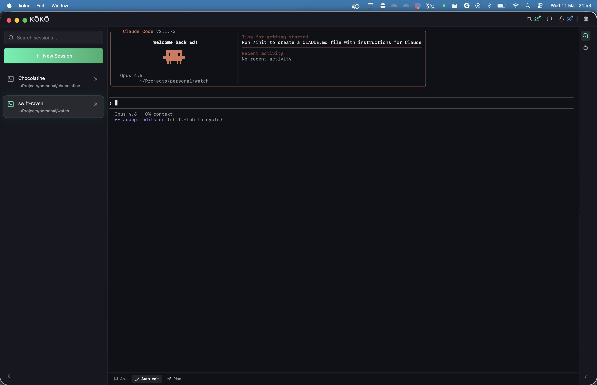
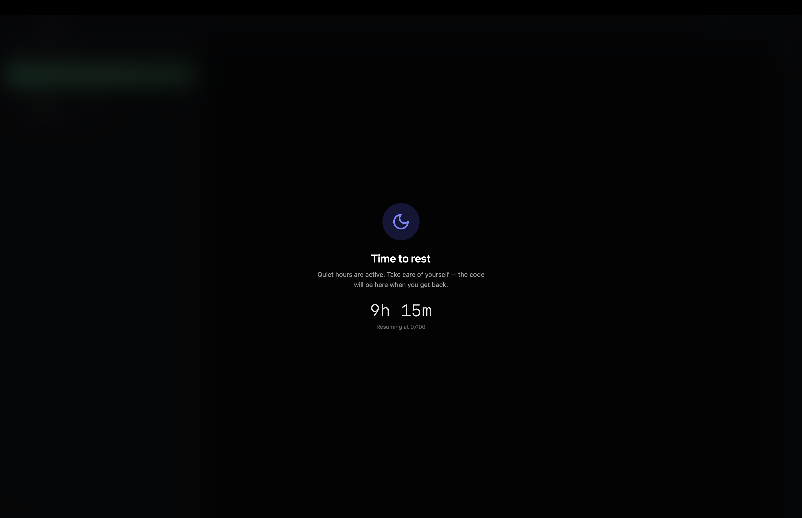
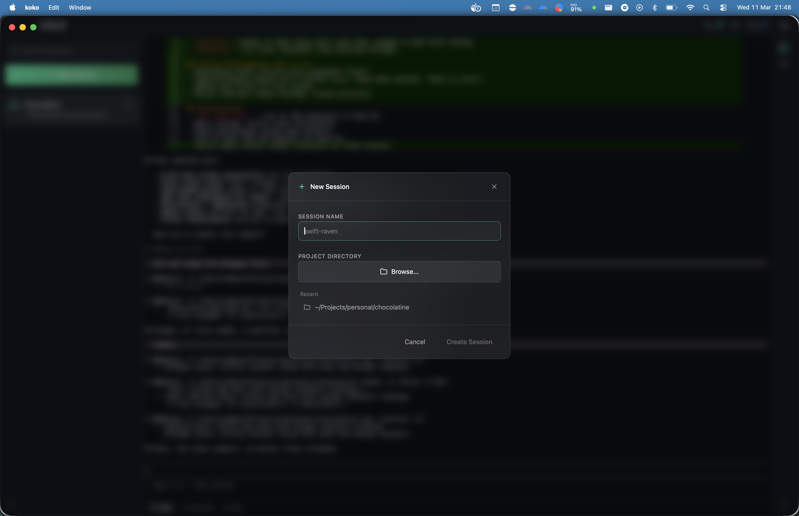

<p align="center">
  
</p>

<h1 align="center">Kõkõ</h1>

<p align="center">
  <strong>A desktop workspace for Claude Code</strong><br/>
  Run several Claude sessions side by side, with GitHub PRs, git changes and remote access in one window.
</p>

<p align="center">
  <a href="https://github.com/edalee/koko/releases/latest"></a>
  <a href="LICENSE"></a>
  
</p>

<br/>

<p align="center">
  
</p>

---

## What is Kõkõ?

Kõkõ is a native desktop app that runs Claude Code in a workspace built for it. It is named after the [Tui bird](https://en.wikipedia.org/wiki/Tui_(bird)).

Each session runs Claude Code in a directory you choose. The left sidebar lists your sessions. The right sidebar shows git changes, CI runs, session context, worktrees and GitHub notifications. PRs open in a full-screen overlay. A local API lets you control sessions from Claude Code (through MCP), a Slack bot or the CLI.

## Features

### Claude Code sessions
- **Named sessions**: a session takes the directory's name, or a name you give it.
- **Full terminal UI**: Claude Code runs in xterm.js v6 with WebGL.
- **Persistence**: sessions survive a restart. Clicking a disconnected tab opens the session dialog with its conversation chosen, so Enter resumes it with `claude --resume <id>`.
- **Conversation picker**: after you choose a directory, start a new conversation or reopen a stored one, newest first, with its title and last reply.
- **One tab per conversation**: Koko refuses to open a conversation that another tab holds, from the UI, the API or MCP.
- **Stable slugs**: a session keeps its slug (such as `koko-1`) across restarts, so the CLI, MCP and Slack always name the same session.
- **Delete conversations**: delete one stored conversation, or all of a directory's. Both ask first, and skip any conversation a Koko tab holds. Deleted conversations cannot be recovered.
- **Housekeeping**: Settings > General clears the session history, and removes worktrees Koko made for closed sessions. A worktree with uncommitted or ignored files stays.
- **Reload session**: restart Claude in place from the sidebar or the terminal's right-click menu. The tab, slug and conversation stay. This helps after you change `CLAUDE.md` or an MCP server.
- **Context display**: the context window use and the model, per session.
- **Approval detection**: a session icon pulses amber while Claude waits for a tool approval.
- **Clipboard**: `Cmd+C` copies plain text and HTML, `Cmd+Shift+C` copies Markdown. The right-click menu has both.
- **Search Web** and **Redraw Terminal** in the right-click menu.
- **Terminal search**: `Cmd+F` searches the scrollback.
- **Git worktrees**: the session dialog can make a worktree on a new branch, so parallel sessions on one repo stay apart. Closing a session offers to remove the worktree Koko made for it.

### Session context
- **MCP servers**: the connection status of each configured server.
- **Agents**: Claude's agents and their models.
- **Commands**: project, global and plugin slash commands. Click one to send it to the active terminal.
- **Subagent monitor**: Claude's child processes, live.

### GitHub and git
- **PR panel**: your PRs and your team's, grouped. Settings > GitHub sets the team (`org/team-slug`), its repos and an age limit for each group.
- **PR detail**: files, diffs, reviews, commits and CI for one PR. You can approve, merge, and read and reply to review threads.
- **CI status**: GitHub Actions runs for the active branch, in the File Changes module.
- **Notifications**: unread GitHub notifications, with a participating filter and mark as read.
- **File changes**: staged and unstaged changes in the session's directory. Click one for its diff, split or unified, with syntax highlighting.
- **Raw file view**: a whole file with syntax highlighting. Koko spots binary files, and asks before it renders a very large one.

### Remote access
- **HTTP API**: list and control sessions, read output and stream terminal data over REST and WebSocket on `localhost:19876`, with a Bearer token.
- **Resume by id**: `GET /api/sessions` lists each session's `claudeSessionId`. Pass one to `POST /api/sessions`, or `claude_session_id` to the MCP `create_session` tool, to reopen that conversation.
- **MCP server**: `koko mcp` gives any MCP client 8 tools to list sessions, read output, send input and list file changes. Koko registers it with Claude Code at startup.
- **Slack bot**: DM the bot `sessions`, `status`, `prompt <slug> <text>`, `send <slug> <text>`, `files`, `output` or `help`. Only the owner gets answers. The Slack tab in Settings is hidden, so the bot runs only if `config.json` already holds a bot token.
- **CLI**: `koko-cli sessions`, `koko-cli tail <slug>`, `koko-cli send <slug> <text>`.

### Safe working
- **Quiet hours**: a time window, such as 23:00 to 07:00, when a full-screen overlay blocks the app.
- **Break reminders**: a break to rest your eyes after a set time at the computer, such as 90 minutes of work and a 15-minute break. Work is time you are active in any app. Time away as long as a break, sleep included, counts as the break.

<p align="center">
  
</p>

### Worker (macOS)
- **koko-worker**: a background agent that runs jobs on the days you choose, even with Koko closed. Each job runs Monday to Friday until you change its days.
- **Stand-up (07:00)**: one Slack DM with today's meetings, your PRs ready to merge and PRs waiting for your review. If you set a Jira site, it also checks each PR against its ticket.
- **Focus time (09:15)**: books "Focus" blocks in free calendar gaps of 30 minutes or more. It books around lunch, 12:00 to 13:00 by default.
- **Review worker**: runs a command you choose on a schedule, in runs. Each run has its own extra arguments, days and times, and targets PRs or repos. A PRs run, such as the "daily" one at 09:30, 12:00 and 14:00, runs a reviewer on each new PR, yours and your team's, and posts its comments on the PR as you. A repos run, such as a weekly one with `--update-deps`, runs a tool once per repo, which can push and open PRs, then sends one Slack DM. It is off until you set a reviewer.
- **Team summary (08:30)**: one Slack DM with what each member of a team merged, opened and reviewed since the last summary. With a Jira site, it adds the status of the tickets their PRs name. Off by default. It needs a team.
- **Settings > Worker**: one switch for the worker, a switch, times and days for each job, Test and Run now buttons, connection checks and the log. It also sets the time zone, the calendar, the Jira site, lunch, Slack and the reviewer.
- **Catch-up and retries**: a job missed while the Mac slept runs on wake. A job waits for the internet, and gets 3 tries for other failures.

### Workspace
- **Quick terminal**: `` Cmd+` `` slides up a shell for the session, in your login shell.
- **Keyboard shortcuts**: `Cmd+N` new session, `Cmd+W` close, `Cmd+1` to `Cmd+9` switch, `Cmd+,` Settings.
- **Update check**: the toolbar shows when a new release is out.

<p align="center">
  
</p>

## Install

### macOS: build from source (recommended)

The app is not notarised, and macOS XProtect can remove an unsigned app after its first launch. An app you build yourself is not affected.

```bash
git clone https://github.com/edalee/koko.git
cd koko
make install-fe
make signing-cert   # once, so macOS keeps Koko's permissions across builds
make build
cp -R build/bin/Koko.app /Applications/
```

See [Build from source](#build-from-source) for what you need first.

### macOS: Homebrew

```bash
brew tap edalee/koko
brew install koko
```

If XProtect removes the app, run `brew reinstall koko`. If macOS blocks the first launch, choose **System Settings > Privacy & Security > Open Anyway**.

### Linux

Download `Koko-vX.Y.Z-linux-x86_64.AppImage` from the [latest release](https://github.com/edalee/koko/releases/latest). The worker is macOS only.

### What you need

- [Claude Code](https://docs.anthropic.com/en/docs/claude-code), signed in with a Claude subscription or an API key.
- For GitHub features: the [`gh` CLI](https://cli.github.com/), signed in with `gh auth login`.
- For the Slack bot: a Slack app with the bot scopes `im:history`, `im:read` and `chat:write`. See [Slack bot setup](docs/references/slack-bot-setup.md). Skip its Settings steps, because the Slack tab is hidden.
- For the CLI: `make build-cli`. It reads `~/Library/Application Support/koko/cli.json`.

### koko-worker setup

The worker uses launchd, `pmset` and `caffeinate`, so it runs on macOS only. `make build` puts `koko-worker` inside `Koko.app`.

It needs these connections. Settings > Worker checks each one and says how to fix a missing one.

- **Slack**: a bot token (`xoxb-`) with the `chat:write` scope, and your Slack member ID. These are apart from Koko's Slack bot.
- **GitHub**: the `gh` CLI, signed in.
- **Claude Code**: `claude` on the PATH, with the claude.ai Google Calendar connector. The stand-up's Jira check also needs the Atlassian connector.
- **Reviewer**: any program that follows the reviewer contract in `docs/plans/030-reviewer-contract.md` and `031-generic-reviewer.md`. Set it in Settings > Worker > Review worker:
  - **Command**, for example `{reviewer} {pr}`. `{reviewer}` is the CLI from a managed clone of a repo, kept up to date before each run, or from a local path.
  - **Logs**, off by default. With logs off, the reviewer writes its comments as JSON to `$REVIEW_RESULT`.
  - **Marker**, the prefix of the comment markers, `<!-- marker:`.
  - **Orgs**, the orgs and accounts whose PRs are reviewed. Empty means every org.
  - **Excluded repos**, `owner/repo` names that are never reviewed.

  In a PRs run the reviewer never posts: its gh and git are read-only, and the worker posts its comments. A repos run gets the real gh and git, so its tool can push and open PRs.
- **Mac wake** (optional): a sudoers rule, so the worker can book wakes with `pmset`. The wake check shows the line to add with `sudo visudo -f /etc/sudoers.d/koko-worker`.

The switch in Settings > Worker installs and removes the launchd agent `com.koko.worker`. You can also run `koko-worker install` and `koko-worker uninstall`.

The worker keeps its settings in `~/Library/Application Support/koko/worker.json`, and its state and logs in `~/Library/Application Support/koko/worker/`. `logs/worker.log` rolls over at 5 MB. Review run logs are deleted after 60 days. PR repos are cloned to `~/.cache/koko-worker/repos`, the repos of repos runs to `~/.cache/koko-worker/repos-runs`, and a managed reviewer to `~/.cache/koko-worker/reviewer`.

## Build from source

You need Go 1.25+, Node.js 22+ and the [Wails CLI](https://wails.io/docs/gettingstarted/installation) v2.16+.

```bash
git clone https://github.com/edalee/koko.git
cd koko
make install-fe     # frontend dependencies
make build          # the app, with koko-worker inside
make build-cli      # koko-cli
make dev            # development mode, with hot reload
make test           # app tests
make test-worker    # koko-worker tests (its own Go module)
```

To update, run `git pull` and build again.

On macOS, run `make signing-cert` once before your first build. It creates a self-signed "Koko Local" code-signing certificate in your login keychain, and asks for your login password to trust it. `make build` then signs Koko.app with it, so macOS recognises each build as the same app. Without it, each build gets an ad-hoc signature, and macOS asks again for the file and folder access you gave Koko and the worker. Set `SIGN_ID` to use another certificate.

## How it works

Kõkõ is a [Wails v2](https://wails.io/) app: a Go backend and a React frontend in a native webview.

```
                  ┌───────────────────────────────┐
                  │          Kõkõ (Wails)          │
                  │  ┌──────────────────────────┐  │
                  │  │ Go backend               │  │
                  │  │ PTY sessions, GitHub,    │  │
                  │  │ git, config, Slack bot   │  │
                  │  └────────────┬─────────────┘  │
                  │               │ Wails IPC      │
                  │  ┌────────────▼─────────────┐  │
                  │  │ React frontend           │  │
                  │  │ xterm.js, panels         │  │
                  │  └──────────────────────────┘  │
                  │  ┌──────────────────────────┐  │
                  │  │ API server (:19876)      │  │
                  │  │ HTTP + WebSocket         │  │
                  │  └────────────┬─────────────┘  │
                  └───────────────┼────────────────┘
                       ▲          ▲          ▲
                  Claude Code  Slack bot  koko-cli
                  (MCP stdio)  (polling)  (HTTP)
```

- **Go backend**: PTY sessions, GitHub through `gh`, git, the Slack bot, Claude's stored data and the app config.
- **React frontend**: the terminals, panels and overlays.
- **Wails IPC**: Go methods become TypeScript functions, and Go structs become TypeScript classes. Terminal data travels as base64 over Wails events.
- **API server and MCP server**: sessions, output and git changes for remote clients.
- **koko-worker**: a separate binary run by launchd. The app edits `worker.json` and calls the binary through `worker_service.go`.
- **Tests**: Go tests for the backend and the worker, and Vitest tests for the frontend.

## Tech stack

| Layer | Technology |
|-------|-----------|
| Desktop shell | Wails v2 |
| Backend | Go 1.25 |
| Frontend | React 19, TypeScript |
| Terminal | xterm.js v6 + WebGL |
| Styling | Tailwind CSS v4 |
| Testing | Go test, Vitest, React Testing Library |
| Remote API | net/http + gorilla/websocket |
| MCP | JSON-RPC 2.0 over stdio |
| Code viewer | @git-diff-view/react + Shiki |
| PTY | creack/pty |

## Project structure

```
main.go                  Wails entry point, `koko mcp` detection
app.go                   App lifecycle, API server, MCP registration, update check
terminal_manager.go      PTY sessions, slugs, subscriber fan-out, --resume
api_server.go            HTTP/WebSocket API (Bearer auth)
mcp_server.go            MCP stdio server
mcp_tools.go             MCP tools
slack_commands.go        Slack bot DM commands (owner only)
claude_service.go        MCP servers, agents, commands, stored conversations
conversation_delete.go   Deleting stored conversations, with ownership checks
github_service.go        PRs, reviews, comments and CI through gh
pr_sources.go            The PR panel's groups: yours and your team's
git_service.go           File changes, branches, diffs, worktrees
worktree_cleanup.go      Removing Koko's worktrees for closed sessions
config_service.go        App config, API key, hidden PRs
process_monitor.go       Child process scan for the subagent monitor
activity.go, idle_*.go   Idle and sleep time for break reminders
worker_service.go        Settings bridge to koko-worker
types.go                 Shared Go types

cmd/koko-cli/            CLI companion
cmd/koko-worker/         Scheduled jobs (own Go module, launchd agent)
  main.go                Subcommands: serve, run, check, status, install, uninstall
  scheduler.go           Due slots, catch-up, retries, state.json
  jobs.go                Stand-up, focus time and review jobs
  summary.go             The team summary job
  review_contract.go     The reviewer command and result file
  reviewer.go            The reviewer: managed clone or local path
  claude.go              Headless `claude -p` runner with allowlists
  calendar.go            Calendar events and the focus gap finder
  jira.go                Ticket checks for the stand-up
  github.go              PR lists through gh
  slack.go               Slack DMs
  launchd.go             Agent install and Mac wake booking
  check.go               Connection checks
  config.go              worker.json, defaults and paths
  logs.go                Log rollover and cleanup

frontend/src/
  App.tsx                App shell and overlays
  components/            Toolbar, sidebars, terminal, PR overlay, settings, dialogs
  components/worker/     The Worker tab's sections and job cards, such as SummaryCard.tsx
  hooks/                 Sessions, activity, GitHub, CI, worktrees, safe working
  lib/                   Pure logic, such as the break timer
  test/                  Vitest tests

docs/
  plans/                 Implementation plans (001-036)
  architecture/          ADRs and the design system
  references/            Setup guides
```

## License

[Business Source License 1.1](LICENSE): the source is available, and non-competing production use is allowed. It becomes GPL 2.0+ on 2030-02-27.

## Credits

Built by [Edward Lee](https://github.com/edalee).

Named after the [Tui](https://en.wikipedia.org/wiki/Tui_(bird)) (Prosthemadera novaeseelandiae), a New Zealand songbird known for its complex song and iridescent feathers.
